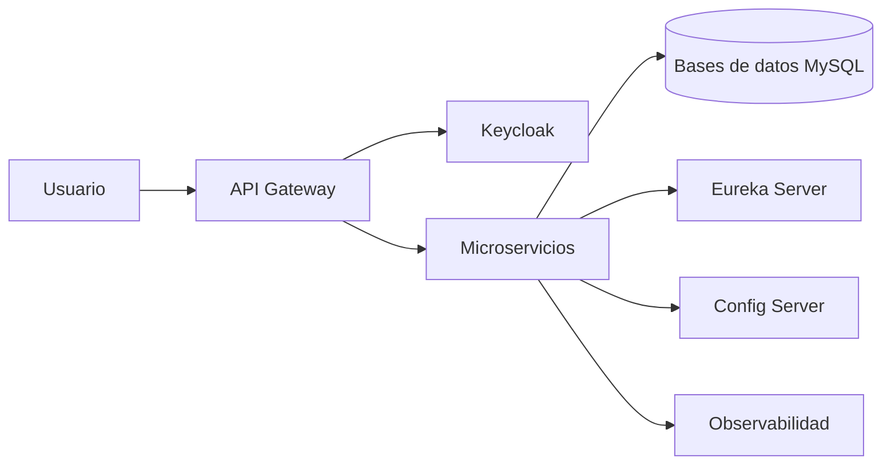

# Arquitectura General

RaymiSupreme utiliza una **arquitectura de microservicios**, donde cada servicio se encarga de una parte específica del negocio.

## Componentes principales

| Componente | Función |
|---|---|
| API Gateway | Punto único de entrada |
| Config Server | Configuración centralizada |
| Eureka Server | Registro y descubrimiento de servicios |
| Keycloak | Autenticación y roles |
| Microservicios | Procesan las funciones del negocio |
| MySQL | Persistencia separada por servicio |
| Grafana, Prometheus y Loki | Monitoreo, métricas y logs |

## Vista general

Esta separación permite mantener y ampliar cada módulo de forma independiente.