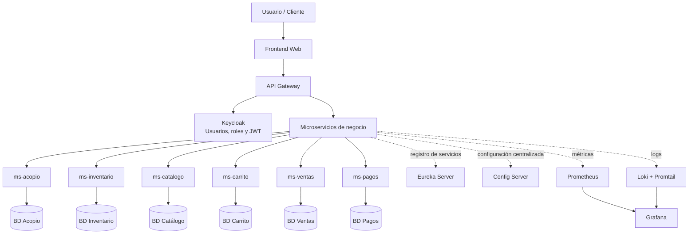

La arquitectura general de Raymi Suprême se organiza en bloques.  
El acceso externo ingresa por el `API Gateway`, que centraliza las solicitudes del frontend y las redirige hacia los microservicios de negocio.

## Lectura del diagrama

El diagrama resume la arquitectura en bloques:

| Bloque | Descripción |
|---|---|
| Frontend Web | Interfaz desde donde interactúa el usuario. |
| API Gateway | Punto único de entrada para todas las solicitudes. |
| Keycloak | Gestiona autenticación, usuarios, roles y tokens JWT. |
| Microservicios de negocio | Procesan la lógica principal del sistema. |
| Bases de datos | Cada microservicio mantiene su propia base de datos. |
| Eureka Server | Permite registrar y descubrir servicios. |
| Config Server | Centraliza la configuración de los microservicios. |
| Prometheus | Recolecta métricas técnicas. |
| Loki + Promtail | Recolecta y almacena logs. |
| Grafana | Visualiza métricas y logs mediante dashboards. |