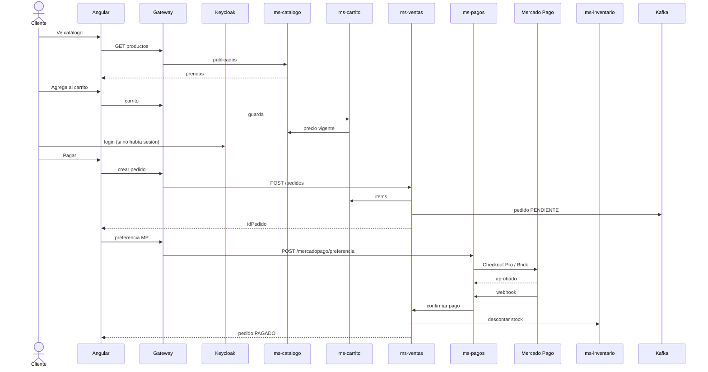

# Flujo de compra

Se puede mirar el catálogo sin cuenta. El carrito también se arma como invitado (queda en el navegador). Para pagar hay que entrar con Keycloak.

## Qué pasa

1. El cliente (o el invitado) mete prendas al carrito.
2. En el checkout, si era invitado, inicia sesión. El carrito se conserva.
3. `ms-ventas` crea el pedido en `PENDIENTE` y publica el evento en Kafka (`pedidos`).
4. `ms-pagos` pide a Mercado Pago la preferencia (Checkout Pro) o registra el Brick.
5. Si Mercado Pago aprueba, el webhook deja el pago en `CONFIRMADO`.
6. `ms-ventas` pasa el pedido a `PAGADO` y `ms-inventario` descuenta stock.
7. El admin puede marcar confirmado / enviado / entregado.

Si Yape directo no responde (cuenta de prueba), la tienda abre Checkout Pro.

## Estados

| Estado | Cuándo |
|---|---|
| `PENDIENTE` | Pedido creado, todavía no cobrado |
| `PAGADO` | Mercado Pago aprobó y se bajó stock |
| `CONFIRMADO` / `ENVIADO` / `ENTREGADO` | Los marca el admin |
| `CANCELADO` | No se completó la compra |

Reglas que importan: el carrito no se fía del precio que manda el front (pregunta a catálogo). El stock no baja en `PENDIENTE`.
