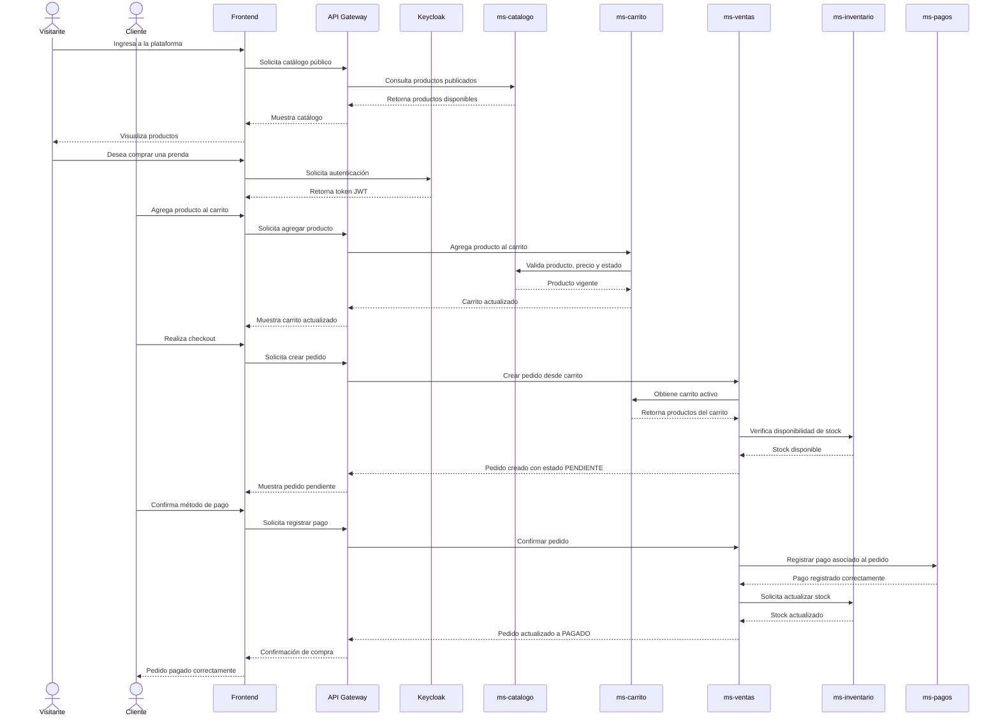

# Flujo de Compra

## Descripción general

El flujo de compra de Raymi Suprême inicia cuando una persona ingresa a la plataforma como **visitante** y consulta el catálogo público de productos.  
En esta primera etapa, el usuario todavía no está autenticado, por lo tanto, solo puede visualizar información comercial pública.

Cuando el visitante desea agregar productos al carrito o realizar una compra, debe autenticarse en la plataforma. Después de iniciar sesión, el sistema lo reconoce como **cliente** y le permite gestionar su carrito, realizar checkout y consultar sus pedidos.

El proceso termina cuando el pedido es confirmado, el pago es registrado y el inventario es actualizado.

---

## Actores involucrados

### Visitante

Es una persona que todavía no se ha autenticado en la plataforma.

Puede realizar las siguientes acciones:

- Consultar el catálogo público.
- Visualizar productos disponibles.
- Buscar productos por material, color o talla.
- Revisar información comercial pública de las prendas.

No puede realizar las siguientes acciones:

- Administrar un carrito.
- Crear pedidos.
- Consultar información interna.
- Modificar inventario, catálogo o ventas.
- Realizar checkout.

---

### Cliente

Es el usuario autenticado que puede comprar productos publicados en Raymi Suprême.

Sus principales acciones son:

- Autenticarse en la plataforma.
- Registrar o actualizar sus datos como cliente.
- Consultar el catálogo.
- Agregar productos al carrito.
- Modificar cantidades.
- Eliminar productos del carrito.
- Vaciar el carrito.
- Realizar el checkout.
- Consultar información relacionada con sus pedidos.

El cliente participa principalmente en las etapas de catálogo, carrito, checkout, pago y consulta de pedidos.

---

## Flujo funcional de compra

El flujo general se divide en las siguientes etapas:

| Etapa | Actor principal | Descripción |
|---|---|---|
| Consulta de catálogo | Visitante / Cliente | El usuario visualiza productos disponibles. |
| Autenticación | Visitante | El visitante inicia sesión para convertirse en cliente. |
| Gestión de carrito | Cliente | El cliente agrega, actualiza o elimina productos. |
| Checkout | Cliente | El cliente solicita crear un pedido desde su carrito. |
| Validación de venta | ms-ventas | El sistema obtiene el carrito y valida la información necesaria. |
| Verificación de stock | ms-ventas / ms-inventario | Se verifica que los productos tengan disponibilidad. |
| Creación de pedido | ms-ventas | Se genera un pedido con estado `PENDIENTE`. |
| Confirmación de pedido | Usuario autorizado / sistema | Se confirma o cancela el pedido según la validación. |
| Registro de pago | ms-pagos | Se registra el pago asociado al pedido. |
| Actualización de inventario | ms-inventario | Se descuenta el stock de los productos vendidos. |
| Finalización | Cliente | El cliente recibe la confirmación de la compra. |

---

## Diagrama de secuencia

---

## Reglas del flujo de compra

Para mantener consistencia entre los microservicios, el sistema aplica las siguientes reglas:

- Un visitante puede consultar productos, pero no puede comprar sin autenticarse.
- El carrito solo puede ser administrado por un cliente autenticado.
- El carrito no debe confiar únicamente en los datos enviados desde el frontend.
- `ms-carrito` consulta a `ms-catalogo` para validar nombre, precio, estado y disponibilidad comercial del producto.
- `ms-ventas` crea inicialmente un pedido con estado `PENDIENTE`.
- Un pedido pendiente todavía no representa una venta finalizada.
- El pedido solo pasa a `PAGADO` cuando el pago fue registrado correctamente.
- El stock se actualiza después de confirmar el pago.
- Un pedido puede ser cancelado si no cumple las validaciones necesarias.
- La modificación de ventas, pagos o inventario debe estar protegida por roles.

---

## Estados del pedido

| Estado | Descripción |
|---|---|
| `PENDIENTE` | Pedido creado desde el carrito, pero todavía sin pago confirmado. |
| `PAGADO` | Pago registrado correctamente y stock actualizado. |
| `CANCELADO` | Pedido cancelado antes de completar la compra. |
| `FALLIDO` | El pago no pudo ser procesado o fue rechazado. |

---

## Participación de los microservicios

### ms-catalogo

Permite consultar los productos publicados para la venta.  
También valida que el producto agregado al carrito siga vigente y tenga información comercial actualizada.

Responsabilidades principales:

- Mostrar productos públicos.
- Filtrar productos por material, color o talla.
- Validar precio y estado comercial del producto.
- Enviar información actualizada hacia `ms-carrito`.

---

### ms-carrito

Administra los productos seleccionados por el cliente antes de generar un pedido.

Responsabilidades principales:

- Crear o recuperar el carrito activo.
- Agregar productos.
- Actualizar cantidades.
- Eliminar productos.
- Vaciar el carrito.
- Validar productos contra `ms-catalogo`.

Este servicio no debe confiar únicamente en el nombre o precio enviado por el usuario.  
Siempre debe consultar la información vigente del catálogo.

---

### ms-ventas

Administra el proceso de generación de pedidos y ventas.

Responsabilidades principales:

- Registrar clientes.
- Crear pedidos desde el carrito.
- Almacenar el detalle de cada pedido.
- Consultar el historial de pedidos.
- Confirmar pedidos.
- Cancelar pedidos.
- Coordinar el pago.
- Coordinar la actualización del inventario.

El proceso de checkout crea inicialmente un pedido con estado `PENDIENTE`.  
Posteriormente, un usuario autorizado o el propio flujo de confirmación puede cambiar el estado del pedido a `PAGADO` o `CANCELADO`.

---

### ms-pagos

Administra el registro del pago asociado a un pedido.

Responsabilidades principales:

- Registrar el método de pago.
- Guardar la referencia de la transacción.
- Actualizar el estado del pago.
- Consultar pagos por pedido.
- Generar comprobantes.

El pago se origina a partir de una venta o pedido generado previamente desde `ms-ventas`.

---

### ms-inventario

Administra la disponibilidad real de las prendas.

Responsabilidades principales:

- Verificar stock.
- Controlar disponibilidad de productos.
- Actualizar cantidades después de una venta confirmada.
- Mantener la relación entre prenda, lote y estado de inventario.

---

## Resultado del flujo

Al finalizar correctamente el flujo de compra, el sistema obtiene los siguientes resultados:

- El cliente queda asociado al pedido.
- El pedido queda registrado en `ms-ventas`.
- El pago queda registrado en `ms-pagos`.
- El stock queda actualizado en `ms-inventario`.
- El carrito puede quedar vacío o cerrado.
- El cliente recibe la confirmación de su compra.
- El negocio mantiene trazabilidad entre catálogo, carrito, venta, pago e inventario.