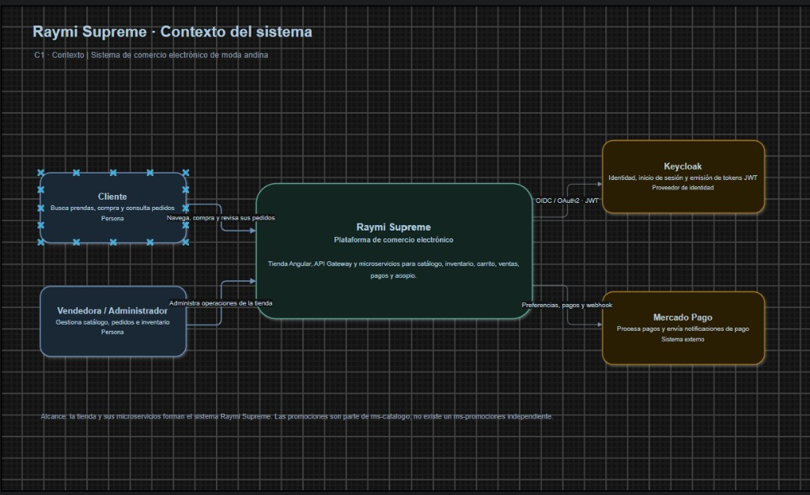
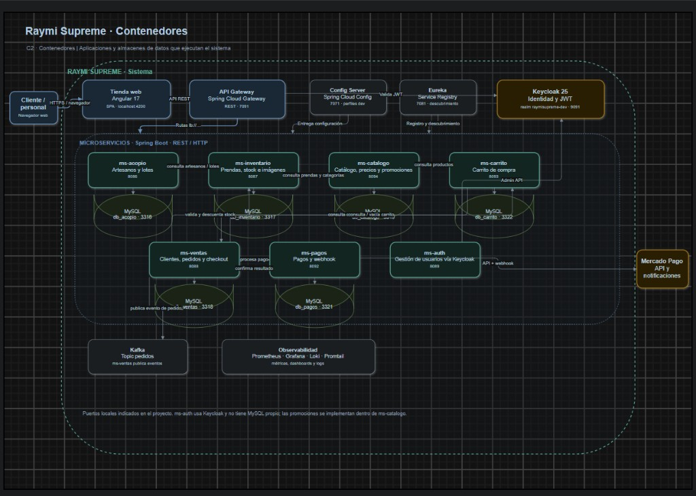
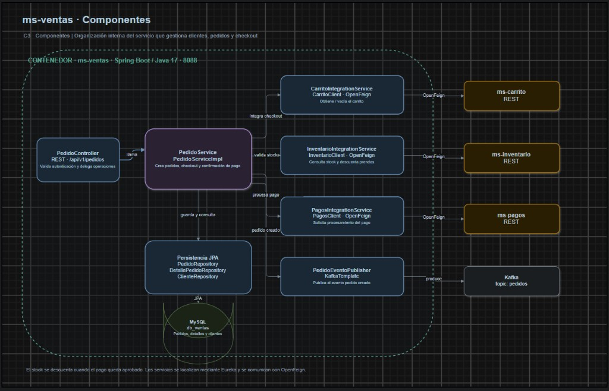
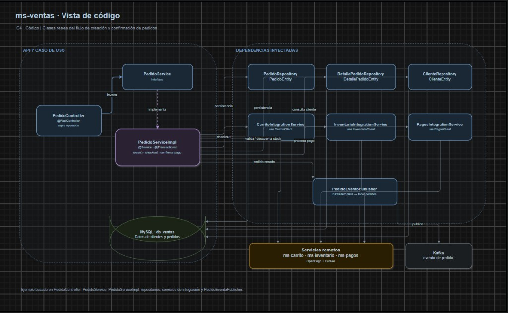

# Modelo C4

C4 sirve para no meter todo en un solo dibujo. En Raymi Suprême hay cuatro cortes: quién usa el sistema, qué piezas se despliegan, cómo está armado `ms-ventas` y qué clases mueven un pedido.

## C1 · Contexto

El cliente entra a la tienda, arma el carrito y paga. La vendedora o el admin ven catálogo, pedidos e inventario. Keycloak autentica y saca el JWT. Mercado Pago cobra y avisa el resultado por webhook.

| Qué | Tipo | Para qué |
|---|---|---|
| Cliente | Persona | Compra y mira sus pedidos |
| Vendedora / Admin | Persona | Atiende la tienda |
| Raymi Suprême | Sistema | Angular, Gateway y los microservicios |
| Keycloak | Externo | Login y JWT |
| Mercado Pago | Externo | Preferencia, cobro y webhook |

Las promociones viven en `ms-catalogo`. No hay un `ms-promociones` aparte.

## C2 · Contenedores

Angular (`:4200`) habla solo con el Gateway (`:7091`). El Gateway valida el JWT y reparte con `lb://...`. Config Server (`:7071`) entrega la config. Eureka (`:7081`) registra las instancias.

Hay siete servicios Spring Boot: acopio, inventario, catálogo, carrito, ventas, pagos y auth. Cada uno de negocio tiene su MySQL. `ms-auth` no guarda usuarios en una base propia: los pide a Keycloak. `ms-ventas` publica al topic Kafka `pedidos`. `ms-pagos` habla con Mercado Pago. Prometheus, Grafana, Loki y Promtail miran métricas y logs.

| Pieza | Tecnología | Qué hace |
|---|---|---|
| Tienda | Angular 17 | Compra y admin |
| API Gateway | Spring Cloud Gateway | Entrada REST y JWT |
| Config Server | Spring Cloud Config | Config central |
| Eureka | Netflix Eureka | Registro de instancias |
| ms-acopio … ms-pagos | Spring Boot / Java 17 | Negocio + MySQL propia |
| ms-auth | Spring Boot | Usuarios vía Keycloak |
| Keycloak 25 | IdP | Realm `raymisupreme-dev` (`:9091`) |
| Kafka | Broker | Topic `pedidos` |
| Observabilidad | Prometheus, Grafana, Loki | Métricas, dashboards y logs |

En local hay dos instancias de `ms-catalogo` (`8094` y `8194`) para ver el balanceo.

## C3 · Componentes de ms-ventas

`ms-ventas` corre en `:8088`. `PedidoController` expone `/api/v1/pedidos`. `PedidoServiceImpl` crea el pedido, hace el checkout y confirma el pago. JPA guarda en `db_ventas`.

Feign llama a carrito, inventario y pagos. `PedidoEventoPublisher` manda el evento al topic `pedidos` cuando el pedido se crea (`PENDIENTE`). Eureka resuelve a quién llamar.

| Componente | Función |
|---|---|
| PedidoController | REST: recibe y delega |
| PedidoServiceImpl | Crear, checkout y confirmar pago |
| Repos JPA | Pedidos, detalles y clientes |
| CarritoIntegrationService | Lee / vacía el carrito |
| InventarioIntegrationService | Stock |
| PagosIntegrationService | Habla con `ms-pagos` |
| PedidoEventoPublisher | Evento a Kafka |

El stock baja cuando el pago queda aprobado, no al crear el pedido.

## C4 · Código de ms-ventas

Esta vista no lista todas las clases del proyecto. Solo el flujo de crear y confirmar un pedido.

| Clase | Rol |
|---|---|
| `PedidoController` | HTTP |
| `PedidoService` / `PedidoServiceImpl` | Caso de uso |
| `*Repository` + entidades | Persistencia en `db_ventas` |
| `*IntegrationService` + `*Client` | Feign a carrito, inventario y pagos |
| `PedidoEventoPublisher` | `KafkaTemplate` al topic `pedidos` |
