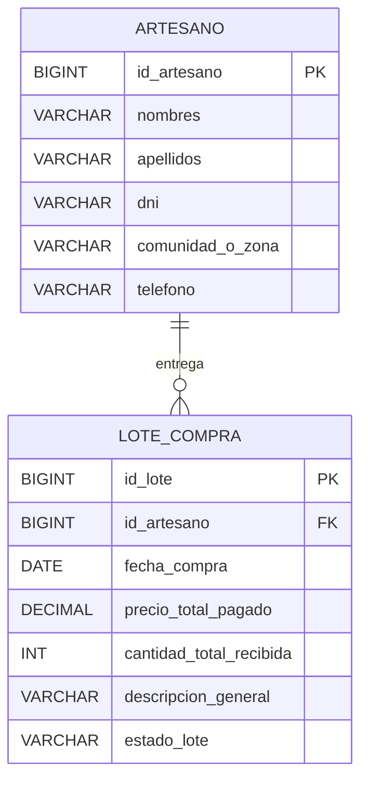
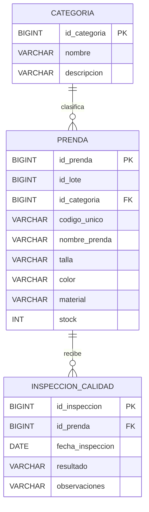
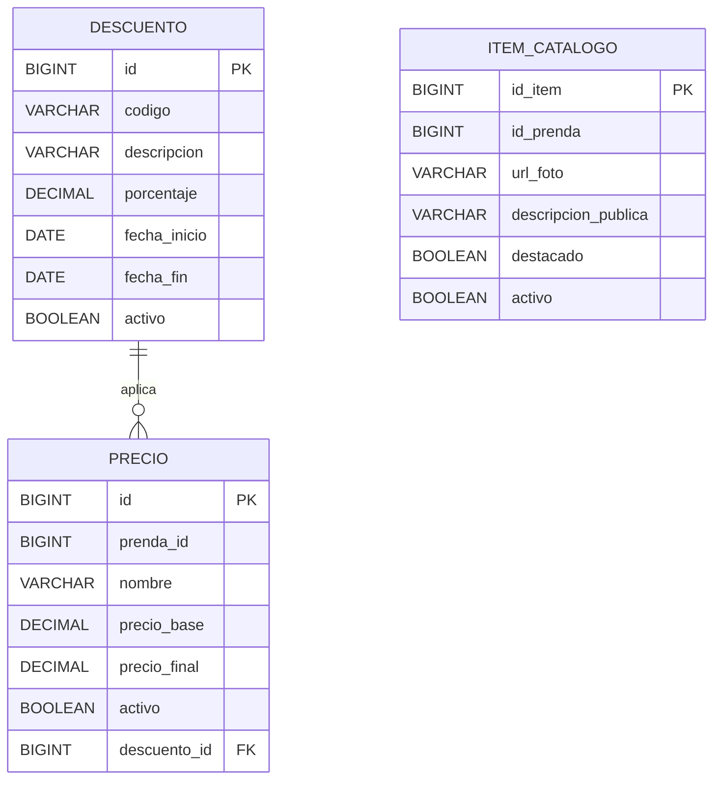
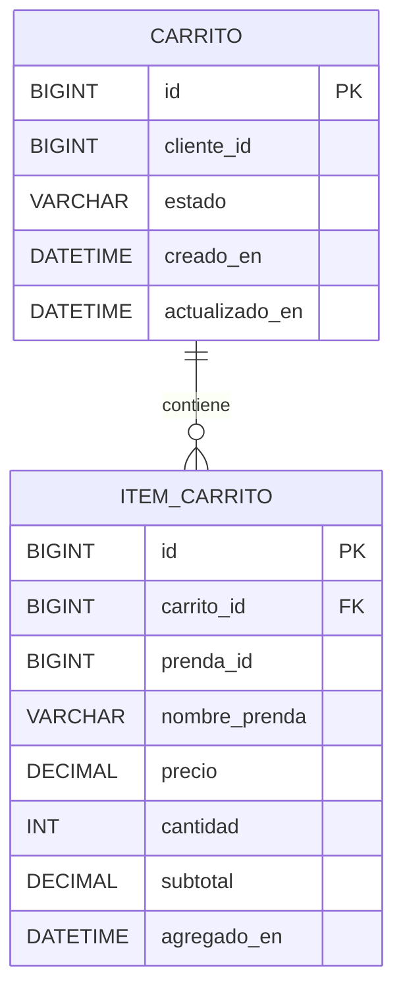
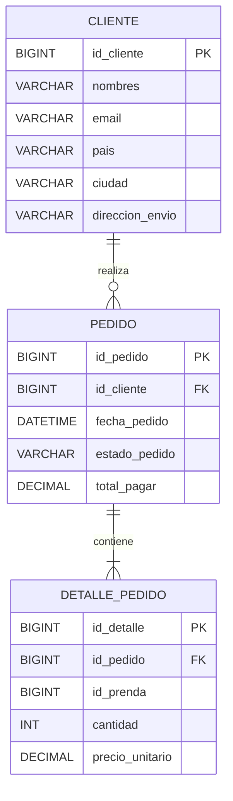
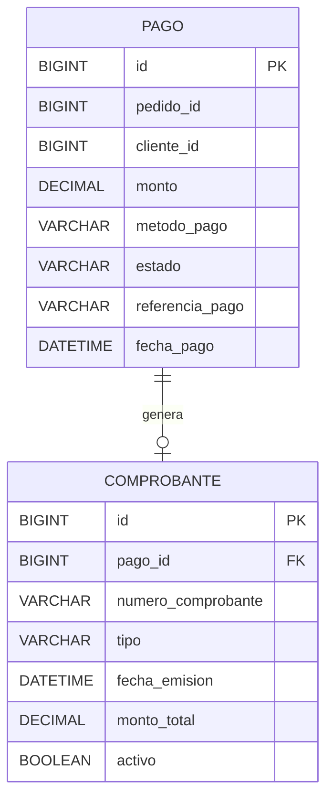

# Base de Datos por Microservicio

## Acopio

## Inventario

`id_lote` referencia lógicamente a `ms-acopio`, por lo que no tiene una clave foránea local.

## Catálogo

`id_prenda` y `prenda_id` referencian lógicamente a una prenda de `ms-inventario`.

## Carrito

## Ventas

## Pagos

