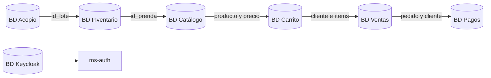

# Modelo General de Datos

RaymiSupreme utiliza el patrón **Database per Service**. Cada microservicio administra su propia base de datos y no accede directamente a las tablas de otro servicio.

## Vista general

## Bases de datos

| Microservicio | Información almacenada |
|---|---|
| `ms-auth` | Usuarios y roles administrados en Keycloak |
| `ms-acopio` | Artesanos y lotes |
| `ms-inventario` | Categorías, prendas e inspecciones |
| `ms-catalogo` | Publicaciones, precios y descuentos |
| `ms-carrito` | Carritos e ítems |
| `ms-ventas` | Clientes, pedidos y detalles |
| `ms-pagos` | Pagos y comprobantes |

Las relaciones entre bases de datos se mantienen mediante identificadores y comunicación REST, no mediante claves foráneas.