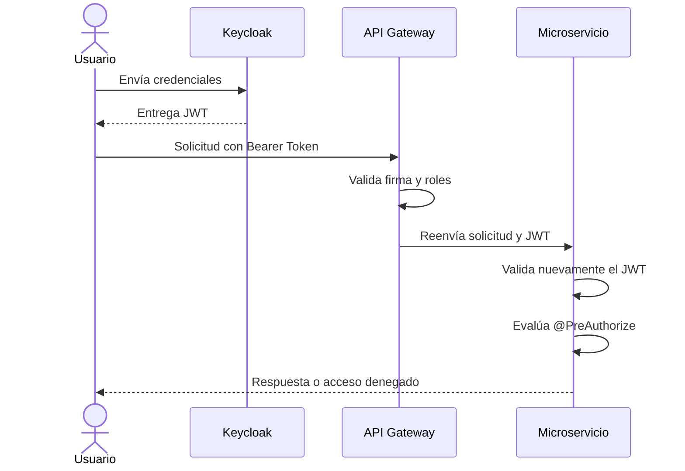

# Modelo de Seguridad

RaymiSupreme utiliza **OAuth 2.0**, **OpenID Connect**, **Keycloak** y tokens **JWT**.

La seguridad se aplica en dos niveles:

1. El API Gateway valida el token y controla el acceso inicial.
2. Cada microservicio vuelve a validar el JWT y aplica los `@PreAuthorize` de sus controllers.

## Flujo de seguridad

## Capas de protección

| Capa | Responsabilidad |
|---|---|
| Keycloak | Autenticar usuarios y emitir tokens |
| API Gateway | Proteger rutas y aplicar roles |
| SecurityConfig | Validar el JWT en cada servicio |
| Controllers | Aplicar permisos mediante `@PreAuthorize` |
| Feign | Propagar el token entre microservicios |

## Características

- Arquitectura sin sesiones.
- CSRF deshabilitado para las APIs REST.
- Autorización mediante roles.
- Validación de firma con las claves públicas de Keycloak.
- Segunda validación dentro de cada microservicio.
- Propagación del token en llamadas internas.

El acceso final depende de la regla más restrictiva entre el Gateway y el controller.